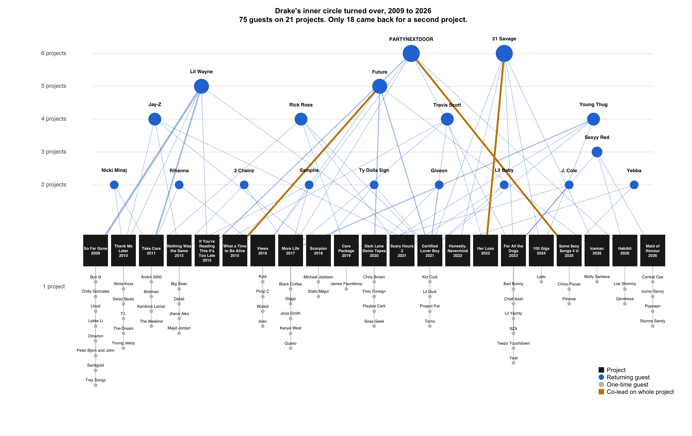
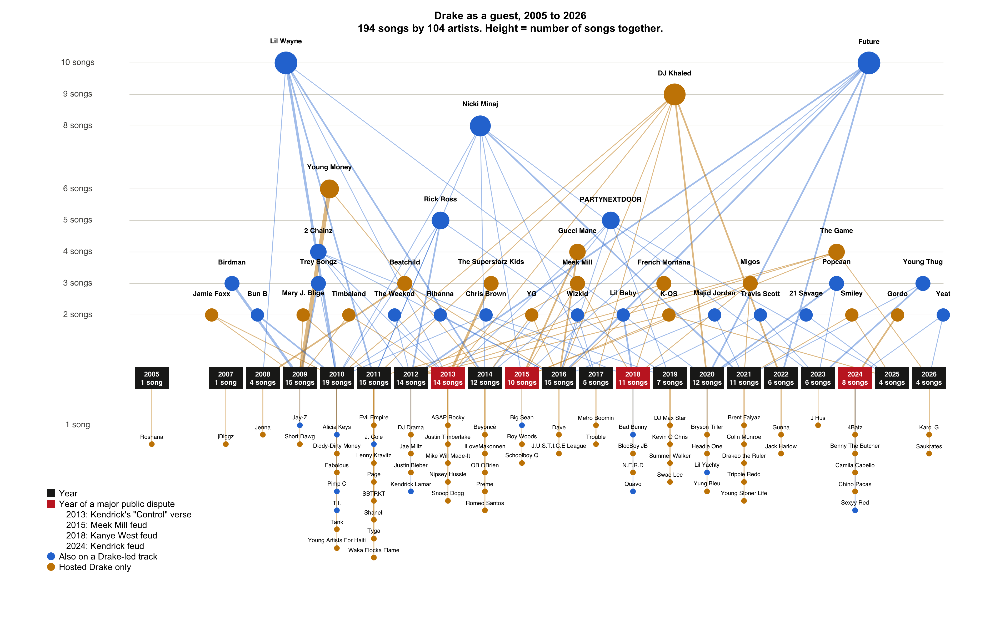

## AI Disclosure

I used Claude, an AI assistant from Anthropic, to help create the data sets. Claude cleaned the Spotify track list, standardized artist names, assigned tracks to projects, calculated tie weights and node positions, and built the node and edge lists. I provided the track list and reviewed the results against Spotifys track list.



{#fig-album}

I arranged both graphs as timelines so they show change over time. Albums or years run from left to right. Artists with more appearances sit higher, and one-time artists are stacked below their album or year. Larger dots show more appearances, wider lines show stronger ties, and grid lines make the levels easier to read.

In the album network, blue marks returning guests, gray marks one-time guests, and gold marks a co-lead on a full album.



{#fig-guest}

In the guest network, blue marks hosts who are also credited on a Drake-led track, and gold marks artists who only hosted Drake. Red year boxes mark four major public disputes: Kendrick Lamar's "Control" verse in 2013, the Meek Mill feud in 2015, the Kanye West feud in 2018, and the Kendrick Lamar feud in 2024. Rows with several artists are spaced evenly in time order.



## Summary

@fig-album shows that Drake's project guests change over time. Only 18 of the 75 guests returned for a second project. Jay-Z and Lil Wayne connect many of the earlier projects, while 21 Savage and Sexyy Red appear only in later ones. PARTYNEXTDOOR bridges both periods, and he and 21 Savage appear on the most projects, with 6 each.

@fig-guest shows that Drake's guest work was concentrated early in his career. The years 2009 to 2016 account for 114 of the 194 guest songs, with a peak of 19 in 2010. Lil Wayne and Future each have 10 songs, followed by DJ Khaled with 9 and Nicki Minaj with 8. Only 36 of the 104 hosts worked with him more than once, so most of these ties were one-time collaborations.

### Collaborations and Public Feuds

Drake fans know the beefs, but the playlist shows the timing behind them. The bridges often fell long before the diss tracks did. The Weeknd's "Live For" and ASAP Rocky's "F**kin' Problems" were released in 2013, more than a decade before both sided against Drake in 2024. Rick Ross shared 15 tracks with Drake, but "You Only Live Twice" in 2021 was the last, three years before "Push Ups." Kendrick Lamar's ties ended in 2013, the year of his "Control" verse, and never came back. Still, beef isn't always final. Meek Mill went from "Back to Back" to "Going Bad," Chris Brown returned with "No Guidance," and Future came back on "Ran to Atlanta" in 2026 after a gap in shared tracks from 2023 to 2025.

These patterns suggest that a quiet period in the network can come before a public feud, but they do not show that feuds ended these collaborations. I selected these artists because their conflicts were publicly reported, and private relationships may have changed earlier.

## Limitations

The years in the guest network are Spotify release dates, so some older songs appear later than their original release. The playlist is fan-made, and Drake is not listed in the credits of 23 tracks. The album network covers 21 projects and leaves out 10 standalone singles and soundtrack songs.



## Sources

- "All Drake Songs On Spotify." Spotify playlist. <https://open.spotify.com/playlist/7b46c5syjtG86a77R7SnMs>
- Spotlistr export. <https://www.spotlistr.com/search/spotify/export/2c125c93-0245-41a0-a7f7-66039377a623?sourceSurface=conversion_pair_page>
- Drake discography on Spotify. <https://open.spotify.com/artist/3TVXtAsR1Inumwj472S9r4/discography/all>
- Wikipedia. Drake album pages and Drake singles discography. <https://en.wikipedia.org/wiki/Drake_singles_discography>
- Music Charts Archive. Drake. <https://musicchartsarchive.com/artists/drake>
- MyStreamCount. Drake. <https://www.mystreamcount.com/artist/3TVXtAsR1Inumwj472S9r4>
- Wikipedia. Drake–Kendrick Lamar feud. <https://en.wikipedia.org/wiki/Drake%E2%80%93Kendrick_Lamar_feud>
- Wikipedia. Drake–Kanye West feud. <https://en.wikipedia.org/wiki/Drake%E2%80%93Kanye_West_feud>
- XXL. Drake and Future reunite on "Ran to Atlanta." <https://www.xxlmag.com/drake-and-future-reunite-new-song-ran-to-atlanta/>
- iHeart. Rick Ross on where he stands with Drake. <https://www.iheart.com/content/2026-04-16-rick-ross-reveals-where-he-stands-with-drake-following-their-beef/>
- Complex. Drake on ending his beef with Meek Mill. <https://www.complex.com/music/2018/09/drake-says-ending-beef-with-meek-mill-gave-him-peace-of-mind>
- Hollywood Life. Drake and Chris Brown's feud. <https://hollywoodlife.com/2019/12/31/chris-brown-reaction-drake-interview-ending-feud/amp/>
- Billboard Canada. ASAP Rocky and Drake's feud. <https://ca.billboard.com/music/rb-hip-hop/asap-rocky-drake-feud-rihanna-1236159586>